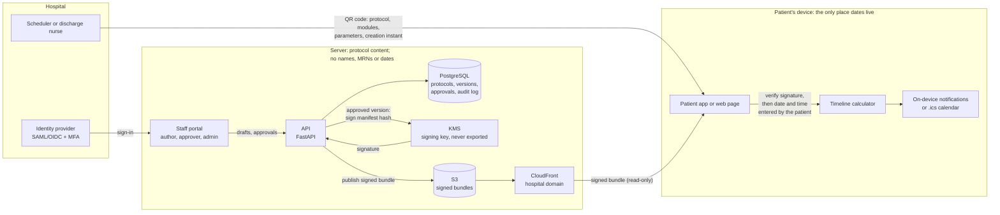

# Data flow: server to phone

Clinical content flows one way, from server to phone. The appointment date and reminders exist only on the patient's device. Source: [the spec](spec.md). Anything undecided is marked OPEN.

## Steps

1. Staff sign in through the hospital's identity provider. An author drafts a protocol in the portal; a different clinician approves it.
2. The API asks KMS to sign the approved version with Ed25519. The signed message is the ASCII label "prep-timeline/manifest/v1" followed by the SHA-256 of the manifest's exact bytes. The manifest lists each module's SHA-256, so the signature covers every module. The signature is published as protocol.sig next to protocol.json.
3. The signed bundle is published to S3 and served by CloudFront under the hospital's domain. Every publish alerts the clinical owner.
4. At scheduling, the clinician ticks the optional modules and fills any parameters, and the patient gets a QR code. At discharge, a second code carries the after-procedure modules. Neither code carries identity, but staff create each one for a known patient, and the module IDs reveal conditions and medications, for example a warfarin hold. OPEN: treat both codes as PHI until decided. OPEN: where the code is generated, and whether its contents pass through the server.
5. The app scans the code, downloads the bundle from the hospital's domain, and refuses it if the signature is missing or wrong, if it is older than the version the app holds, or if it is the same version with different bytes. It caches the bundle offline. The request leaves the device's IP address and the protocol ID in API or CDN logs, which can link a person to a procedure. OPEN: treat those logs as PHI until retention is decided.
6. The patient enters the procedure date and time on the device. The calculator computes the timeline and reminders, which are scheduled on the device. The web fallback offers a calendar download instead.

## Trust boundaries

- Hospital identity provider to portal: staff identity only.
- Server to device: one way. Nothing the patient enters goes back, but each download request carries the device's IP address and the protocol ID (step 5). OPEN: whether the check for a newer safety-relevant version on app open sends anything beyond the protocol ID and version.
- KMS: only the approval service may request a signature.
